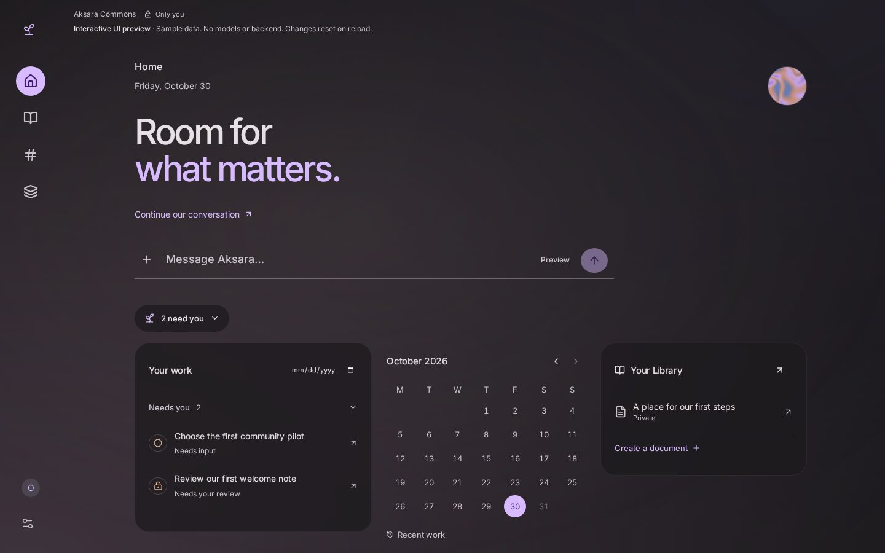
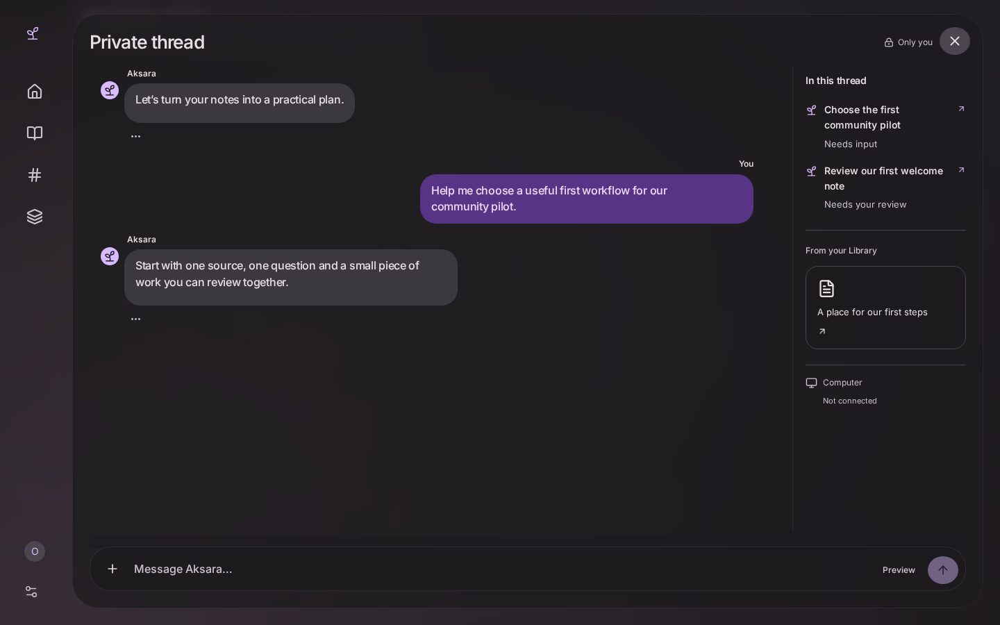
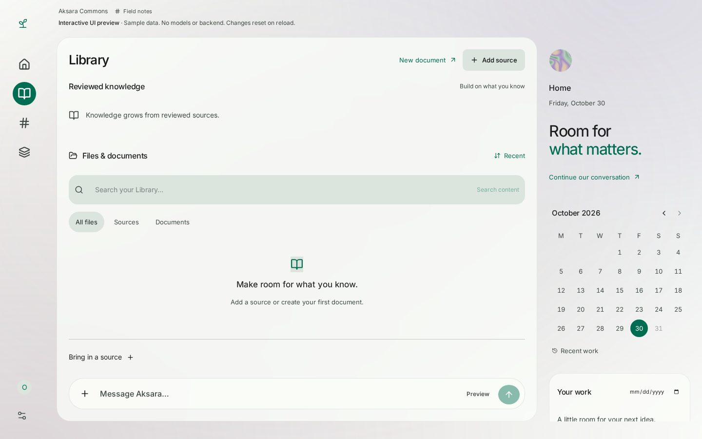
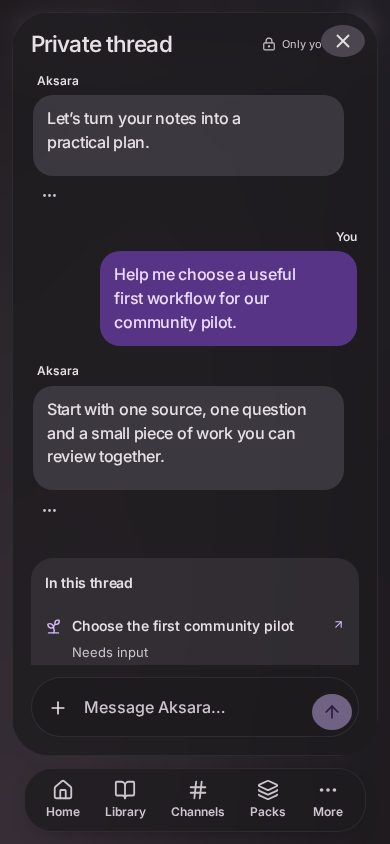
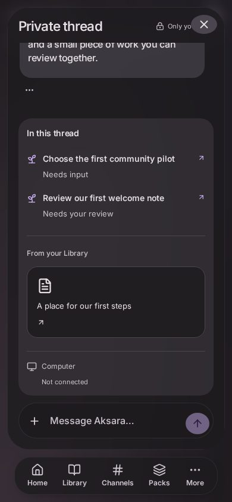

# Expressive workspace visual QA

Date: 30 October 2026 (Asia/Bangkok)

final result: passed

Target: the user's selected Hark-like atmospheric ergonomics, followed by the
explicit dock/mobile-row/blob/composer refinements. This adapts those references
and the accepted design specification; it is not a pixel clone or a claim about
Hark's private implementation.

Fresh Chromium production-preview captures were opened and inspected at
1440×900 and 390×844: light Sage Library, dark Home, private/shared threads,
phone inline work and a 390×420 compact-height composer. Provided Hark
screenshots and actual Cult registry source ground the visual/interaction review.
Earlier generated images establish workspace structure; the latest explicit
refinements supersede their opaque rail.

## Review and repair loop

- Removed the opaque rail frame and fixed collapsed icon geometry. Measured
  horizontal/vertical icon-center error is zero pixels. Phone dock navigation
  is direct; More retains a focus-trapped secondary sheet.
- Repaired the mobile More resize race by opening mobile state explicitly.
- Repaired a full-width rule extending the fixed private surface and its send
  control beyond the viewport. It now accounts for collapsed/expanded desktop
  navigation and phone safe-area spacing.
- Reduced message type/weight/spacing, restored a real multiline composer and
  kept phone Activity inline. Compact send bounds are x=312, y=346, width=40,
  height=36 inside a 390×420 viewport.
- Home and full thread use the same draft and canonical messages, with one
  visible composer. Source withdrawal and scope checks clear restricted content.
- Home contraction precedes surface reveal. Reduced motion skips choreography;
  interrupted layout has a bounded fallback.

## Evidence

The capture run has no page errors. The actual shader appears in normal captures;
reduced effects also exercises the fallback. Taste v2 at 1440/768/390 reports no
findings with explicit aesthetic allowances: lilac, large Home statement,
independent panel heights, sparse real calendar hue, and the user-requested
procedural smoke gradient. No accessibility finding is waived. This is not a
full WCAG conformance audit.

24 preview checks, 20 real-host product checks and eight existing privacy/approval
browser smoke checks pass. Material supplies paired color roles; static
inspection does not establish every moving composite/native-device condition.
Real Surface/A12 GPU, keyboard, battery and frame-time measurement remains.

No P0/P1/P2 visual issue remains in captured states. P3: tune glass density,
springs and atmosphere with real device feedback. Weather input, custom seeds
and routed deep links remain outside this checkpoint.
