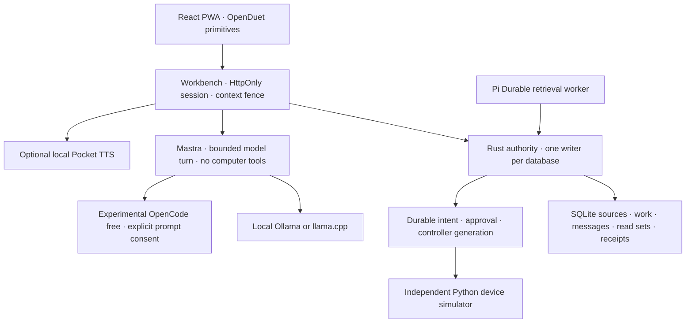

# Aksara platform foundation

Implementation checkpoint: 29 October 2026 (Asia/Bangkok). This is a development foundation guided by the accepted v2.5.5 catalogue and Platform Harness v0.2 review. The earlier alpha remains available as the conformance lab. Original private architecture documents are not redistributed in this public repository.

## Run it

Requires Rust 1.99, Python 3.10+, Node 24.19+ and npm. No cloud account, Docker, systemd or model is required to use Library, documents, reviewed memory and the simulator.

```sh
cargo build --locked --workspace
npm ci
npm run build
npm run platform
```

Open **http://127.0.0.1:7341**. The development chooser offers Operator, Maria and Yohan. It is intentionally a local testing facility, not real authentication. The main PWA is `apps/platform`; `apps/web` is the preserved alpha lab served by `scripts/dev.py`.

The launcher creates a community database and three separate one-person personal databases under `.aksara/platform/`. Credentials are host-side files with mode 0600. Default service ports are 7350 (simulator), 7351 (community), 7353/7355/7357 (personal hosts), and 7341 (web workbench). `--service-base` and `--port` allow an isolated test instance. Use Ctrl-C to stop all children.

Try this path:

1. Enter as Operator; add a private source in Library.
2. Draft a document, prepare it, inspect the exact arguments, approve, then execute. Inspect the verified receipt.
3. Propose an exact source excerpt for memory; review it in Tools.
4. With a local model, select sources in Ask and send a prompt. Aksara records the actual input and dependencies.
5. Withdraw a source. Dependent replies disappear and cannot re-enter a subsequent model context.
6. Switch to personal mode or a shared Channel. Private community artifacts do not follow you.
7. In community Tools, prepare, approve and execute a semantic simulator indication.
8. Select a past date in Today. Dates before recorded work remain empty.

## Hosted UI preview

[Open the hosted preview](https://aksara-core-preview.pages.dev). [Pages deployment details](../../deploy/pages/README.md).

`npm run build:preview` creates `apps/platform/dist-preview` for Cloudflare Pages. It uses the same UI with a build-time, tab-local sample transport. The regular `npm run build` still talks exclusively to the real host and excludes that sample module.

The hosted preview opens on Today with labeled sample work. You can explore private/shared sample contexts, Library search, document review, memory controls and a guided OpenUI response. These are UI demonstrations, not Rust authorization/effect proofs. Every simulated result is labeled `PREVIEW_ONLY`. No model, device, private backend, account or remote user-data store is connected. Reload resets tab-local data; other visitors have separate state. Do not put important work into the preview.

Pages serves static assets. A minimal `/api/*` guard returns HTTP 501 to explicitly reject live-backend requests; the UI sample transport never makes those requests. Camera/microphone access is disabled for the preview origin. Eleven browser checks cover disclosure, sample review, tab isolation, no network data egress, reset, history, responsive layout and the API guard. `node tests/preview-browser.mjs` tests the build locally; `AKSARA_PREVIEW_URL=https://… node tests/preview-browser.mjs` checks a deployed version.

Pages build settings: repository root, `npm run build:preview`, output `apps/platform/dist-preview`, Node `24.19.0`, production branch `main`. `deploy/pages/` contains the guard, routing and response headers. This deployment is separate from the production architecture.

A live Rust/SQLite backend needs a Linux host and a persistent volume. The connected Cloudflare account rejected Containers with “Workers Paid plan required.” Cloudflare also documents container-local disks as temporary. No billing plan is changed and the canonical database is not moved into a throwaway container filesystem. A [protected operational test-host profile](../../deploy/test-host/README.md) packages the real stack with a password gate, exact-origin forwarding, separate personal databases and a persistent Docker volume.

## Architecture and repository boundaries

One monorepo currently keeps authority changes, adapter changes and first-party client changes reviewable together. Rust never delegates authorization to a frontend, model, runtime thread ID, Pack manifest or device connection.



`crates/core-types` and `crates/kernel` own canonical state and eligibility. `services/aksarad` hosts the loopback API. `packages/workbench` serves the built client and brokers bounded model/audio requests. `packages/runtime-mastra` uses the actual Mastra Agent API; `packages/runtime-pi` retains the existing durable retrieval/proposal task. `packages/contracts`, `protocols/aksara/v1` and `packs/knowledge` define the first strict, non-executable Pack/surface profile. Python Device SDK behavior and simulator remain independent of daemon lifetime.

Keep Strata/Ruara's social system separate. Its membership and publication decisions remain receiving-side authority. Keep hardware CAD/firmware and distributable Device/Pack SDK release boundaries explicit; an SDK consumer should not need private core internals. Native apps may stay in this monorepo until their team/release requirements justify separation. No split is required to start.

## Authority and read dependencies

Schema 3 migrates existing schema 1/2 databases. It adds conversation runs/messages, frozen model inputs, lane labels, and WorkObject history. Existing source bytes, effect/receipt behavior and source lineage remain canonical.

Each model run binds the current owner, lane revision, audience snapshot, purpose, policy epoch and WorkObject. A durable execution claim prevents duplicate delivery and host restart from automatically invoking the provider again. Interrupted work requires explicit interruption and a new user turn. This adapter does **not** claim Mastra crash recovery, live stream resumption or durable tool loops. Pi's existing checkpoint/replay qualification remains separate.

For local turns, the user selects up to eight eligible sources. Rust materializes the bounded conversational history and selected source bytes once, stores the exact input with its SHA-256, and records the conservative union of source dependencies of every included turn. Follow-ups inherit actual dependencies, independent of model-written citations. Before input delivery and before output commit, the kernel rechecks current context, active work and transitive source eligibility. Message reads apply current audience and source eligibility too. Withdrawal therefore blocks dependent replies before any later projection cleanup.

Model context is limited to 32 KiB and the latest 80 candidate messages. At most 50 source dependencies can enter a run. The frontend shows the latest 200 eligible messages; earlier messages remain canonical but older-message browsing is not implemented. Library listing is bounded. These are development resource ceilings, not a claim of complete long-context memory.

Approved memory remains a separately reviewed source-excerpt store. It is not silently injected into the new model adapter. Rich memory/OM/summary/subagent integration must carry the same actual-read dependency checks before being enabled.

The workbench admits one model call at a time across its configured contexts; the kernel also admits one running turn per lane. Output is committed before it is visible in the browser. There is no partial model output stream to leak after revocation. A process crash may consume provider compute while leaving an interrupted turn; it never proves a reply or authorizes an effect.

## Models and offline behavior

The default model path is local. Start Ollama at `127.0.0.1:11434`; installed models are discovered through `/api/tags`. The workbench also discovers llama.cpp through `/v1/models`. Set `AKSARA_LOCAL_MODEL_PORT` in the trusted host environment to use a different loopback port. Browsers cannot set arbitrary inference URLs. Ollama downloads require an explicit user action; a llama.cpp endpoint does not acquire an Ollama download capability.

A real CPU llama.cpp run using SmolLM2 135M succeeded here through Mastra. This verifies a working provider seam, not suitable reasoning quality or A12 speed. No model weights or model runtime binaries are bundled. The small model is a connectivity/resource fixture.

OpenCode's pinned public provider source enables keyless access with the public credential and disables nonzero-input-cost models when no account/key exists. Our synthetic completion reached `https://opencode.ai/zen/v1/chat/completions` but returned **HTTP 429 FreeUsageLimitError**; catalogue GETs returned 403. A shortlist of free-model candidates is a UI hint, not verified current entitlement. This path is explicitly experimental, sends no account credentials, and has no paid/provider fallback.

Hosted turns require per-turn consent. Rust excludes local-only turns and Library source injection from hosted context; previous hosted turns enter only the same consented hosted provider. A user can still intentionally type/paste information into a hosted prompt. Model-provider retention/training terms remain external terms, not local custody guarantees.

Without WAN, local Library, reviewed documents, memory, simulator and installed local model paths remain useful. The PWA service worker caches public shell assets only; it never caches API responses or private audio. A disconnected browser cannot write to a stopped/unreachable host, and no offline intent queue is implemented. LAN HTTPS, pairing and native browser permissions are pending; localhost development is not evidence that LAN offline installation works.

## Today, Channels, documents and screens

Today is a live polling projection of the **currently selected conversation**, not an office-wide omniscient feed. Work history is captured by database triggers so direct effect-driven work updates are included. The migration checkpoint records state at migration time; it does not invent older history. Historical views apply current access as well as the recorded audience. This version does not reconstruct past document content, membership, messages, calendars or a complete office view.

Private Ask returns to the user's private community thread. Shared Channel conversations show their audience. Personal mode changes the authority host/database, clears drafts/restricted UI state and fences late responses. Tokens remain server-side; the browser uses an HttpOnly SameSite=Strict session cookie and a changing context token. Requests check the exact loopback Host and write Origin. This is development session handling, not enrollment, production IAM, TLS or OS isolation. Browser state is cleared on authorization/context errors.

Document creation follows explicit prepare → exact review → approval → execution → verified receipt. A document made from a source or model reply carries its source dependencies. The alpha Library has private/institution visibility, not per-Channel artifact ACLs: institution-visible documents can be eligible from other conversations in the same institution. Channel-only collections and named custody rights need a separate policy increment. Document content is plain text/Markdown as text; arbitrary HTML is not executed. Operator approval remains the alpha policy and does not solve the future named-rights/custodian review model. Non-Operator private work cannot be reviewed through an omniscient Operator content bypass.

OpenDuet's MIT brief/card/icon/motion components and visual tokens are actually reused, with attribution. Its Intelligence backend and CopilotKit tool authority are not imported. The shell is reworked for Aksara. Actual OpenUI Lang renders only the initial registered `EvidenceCard` and `MetricCard` text profile. Programs are reduced to a validated single component and bounded string arguments before entering the renderer; Query, Mutation, expressions, arbitrary actions/HTML and network URLs are not admitted.

The bundled Knowledge Pack has a strict manifest. `/api/packs` validates it before exposing it. Pack capabilities are declarations, never grants. Untrusted third-party Pack installation, signatures, executable plugins, a general objective graph and Wasmtime are pending.

## Local voice

Pocket TTS read-aloud is opt-in and separate from microphone capture. Run a local worker yourself:

```sh
# Install into a separate Python environment. Prefer a CPU Torch build.
python3 -m venv .venv-voice
.venv-voice/bin/pip install torch --index-url https://download.pytorch.org/whl/cpu
.venv-voice/bin/pip install pocket-tts==4.0.1
OMP_NUM_THREADS=2 .venv-voice/bin/pocket-tts serve --host 127.0.0.1 --port 7361 --language english_2m_2026-10
# In another terminal, opt in before starting the platform:
AKSARA_TTS_ENABLED=1 npm run platform
```

The UI can request a short eligible assistant reply by message sequence, not arbitrary speech/voice URLs. The broker strips code blocks, bounds input/audio, permits one synthesis at a time, rechecks message eligibility after synthesis, finalizes streaming WAV lengths, and returns no-store PCM audio. Switching contexts stops playback and discards late audio. It cannot retract speech already heard. This is not a full spoken conversation/STT/voice-note pipeline, multilingual quality qualification, or physical-device capture authority.

Pocket TTS 4.0.1's `english_2m_2026-10` produced a real three-second synthetic WAV here. The Python worker used about 573 MiB RSS including Torch, despite small model weights. The language list does not include Indonesian. Keep voice optional and measure on the actual phone before making it resident. We do not enable voice cloning or microphone access.

## Computers, hardware and publication joints

Computer execution remains disabled. A private Ask computer and a Channel computer must be distinct scoped sessions with controller generations, current observation bindings, explicit tool admission, durable remote intents, outcome reconciliation and artifact postconditions. `computer-intent.schema.json` is a contract draft for those joints, not a provisioned VM or shell API. PRoot must not be presented as production isolation. Add a real backend only after stale observation, human takeover, secret/egress and crash tests pass.

Pamir's [Lapis One](https://www.pamir.ai/) is a useful appliance reference: its official page describes a Debian-based RK3576 host, 8 GB RAM, memory LCD, GPIO, USB-C capture/HID KVM, signed A/B updates and a continuity battery. These are vendor claims, not our hardware measurements. The same page says internet is required; Aksara's local-first requirement must be qualified independently. No usable licensed Lapis SDK source was established during this pass, so no Pamir source is copied. HID/KVM authorization is an actuation boundary, not ordinary screen rendering.

Muse's production-shared renderer/host simulation remains the renderer target. Our independent four-profile Python behavior simulator is not a Muse-compatible firmware emulator, physical Lapis implementation, or proof of radio/power/timing parity. Existing semantic indications, controller stop/privacy, generation fencing, durable destination receipts and reconciliation remain exercised by the process/browser fixtures.

Ruara/PyFedi publication remains a reviewed boundary. `publication-draft.schema.json` requires a SharingGrant identifier and a public projection digest. No forum posts are sent. A schema field alone is not a SharingGrant evaluator: release, receiving-side admission, deduplication, correction/retraction, origin authentication and compromised-peer tests are required before enabling a real adapter.

## Next promotion gates

See [the full component coverage map](component-coverage.csv). Immediate next work is A12 measurement; real enrollment/named review rights; qualified Mastra durable/tool recovery with source invalidation; and one isolated computer backend. Expand rich Library parsing, source-aware memory, voice capture and external channel/publication adapters only with their named proofs. Expo follows native camera/audio/background/secure-storage needs; Tauri/Electron follows a measured desktop integration need. Preserve the ecosystem without turning every design target into an enabled runtime dependency.
