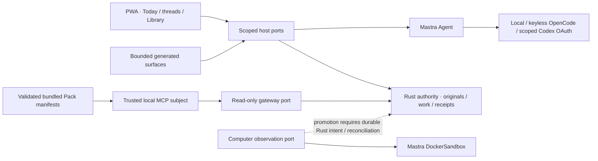

# Fluid workspace checkpoint — 29 October 2026

The desktop surface now uses a collapsed shadcn sidebar-08 inset shell, Octopus
surface and resize primitives, and Cult expansion, progress and setup primitives.
Today contains Aksara's composer and latest accepted reply directly on the page.
Private conversations, channels, Library, document review, governed memory,
local speech and the hardware simulator still use the same Rust-backed host.

The palette uses graphite grounds, the pale lilac family observed in Westpapua
Watch, and a restrained warm decision accent. The Abstraksi public preview was
not retrievable here; no private Abstraksi code or assets were copied. Light mode
uses the same semantic roles. Fonts are local; text scales with the browser's
root font size. Navigation becomes a focus-trapped drawer on phones.

## Shared joints

- `workspace/state.tsx` holds scoped first-party state and clears drafts,
  restricted views, audio and approvals when custody or audience context changes.
  A rejected authorization response also clears unsent restricted content.
- Screens and overlays are separate components. Secondary screens and setup are
  lazy loaded. Octopus's measured split-pane behavior supplies the document
  context pane, including pointer/keyboard resizing. Restricted children are
  never retained for closing animations.
- Cult ExpandableScreen uses Base UI Dialog for focus, Escape and scroll-lock
  cleanup. Expandable respects reduced motion; HaloProgress has flat materials
  and uses indeterminate progress for unknown duration. Setup reuses the Cult
  wizard with scoped host actions. The sidebar starts collapsed and can expand.
- `SurfacePort` is deliberately smaller than the workspace controller. Generated
  OpenUI can resolve a bounded list of resource IDs and open trusted host views;
  it cannot approve, execute, change a session or fetch arbitrary URLs.
- `aksara.resource-surface/1` accepts WorkList, SourceList, DocumentPreview and
  ProgressStatus. Literal-only OpenUI parsing is shared by host and frontend.
  Resolution re-reads Rust-authorized resources, rejects a changed scope and
  normalizes unavailable documents without returning hidden metadata. Responses
  expire after ten seconds and refresh in the visible component. No rendered
  value is an authorization grant, and no percentages are invented.

## Models and onboarding

Local OpenAI-compatible models and experimental keyless OpenCode use the actual
Mastra Agent. OpenCode's public credential is not an entitlement: a new synthetic
live probe on 29 October returned HTTP 429. No paid fallback is enabled.

Codex subscription inference also goes through that Mastra Agent. A focused
Apache-2.0 port of Mastra Code SDK's device authorization and Responses provider
avoids installing the full coding harness, databases, browser runtimes and
embedding dependencies on a phone. See its `vendor/mastra-codex/UPSTREAM.md` for
source hashes and adaptations. No Codex CLI is required. The initial CLI App
Server experiment was replaced after studying the native Mastra implementation.

Credentials are encrypted at rest, with a separate host-side key/store per Rust
institution and principal. They never enter browser state, generated UI, the
Library or model prompts. Device authorization is cancellable, rate limited by
its upstream poll interval and fenced before saving. Refresh is serialized;
signing out invalidates in-flight provider results. There is no environment-key,
other-application credential-store or paid-provider fallback.

Setup offers local, OpenCode free and ChatGPT subscription paths. A test message
uses a real canonical model run; saved sign-in and a successful accepted response
are shown separately. Every hosted turn requires fresh consent; Library and
local-only turns remain excluded from hosted context. Candidate Codex model IDs
are not a claim of account entitlement. No real ChatGPT account was signed in
here: actual OAuth completion and a live subscription response need the user's
account and remain unqualified. Automated tests exercise the real Mastra Agent
and upstream transport with synthetic OAuth/SSE fixtures.

## Scope of this checkpoint

The Pages build remains a clearly labeled disposable interface preview. It does
not host Rust or perform sign-in, inference, device IO or persistent user work.
The real local host build is separate and exercises Rust/Node adapters.

Computers, gateway/skills/ACP/MCP, richer memory and the domain catalogue remain
tracked in `component-coverage.csv`; source research and follow-on implementation
must retain these same authority joints. No browser animation proves execution,
no donor account defines membership, and no new memory engine is implied.

Gooey filtering and shader presence remain optional enhancements pending phone
measurements. The shipped presence uses a static shape with a small animation
only while real work is active. This checkpoint does not claim A12 performance,
production identity enrollment, full historical office replay or a native app.

## Ontology companion

The uploaded v2.5.6 research is context, not an instruction to replace the memory
architecture. Its useful constraint is retained: ontology bundles are versioned
Library/Pack artifacts; source-backed observations and inferences remain distinct
reviewed derivatives. Valid time and record time, disputed mappings and withdrawal
must survive future projections. Ontologies do not confer access or force a
mandatory graph backend. No uploaded private source document is redistributed.

## Follow-on gateway qualification

The [gateway ports](../../packages/gateway/README.md) now include native Mastra
MCP resource serving, with a real stdio/Rust test for private scope, withdrawal
and bundled Pack discovery. Knowledge Pack 0.2 declares the registered resource
screens as well as text cards. The isolated Mastra Docker observation port was
also tested against a dedicated immutable non-root image, with 128 MiB configured
memory, fixed CPU/PID limits, no network and no host mounts. This qualifies a
backend joint; it does not enable product command execution or persistent
private/shared computers. Those promotion gates remain explicit in the coverage
matrix. The UI/model preview is deployed independently of these host adapters.

