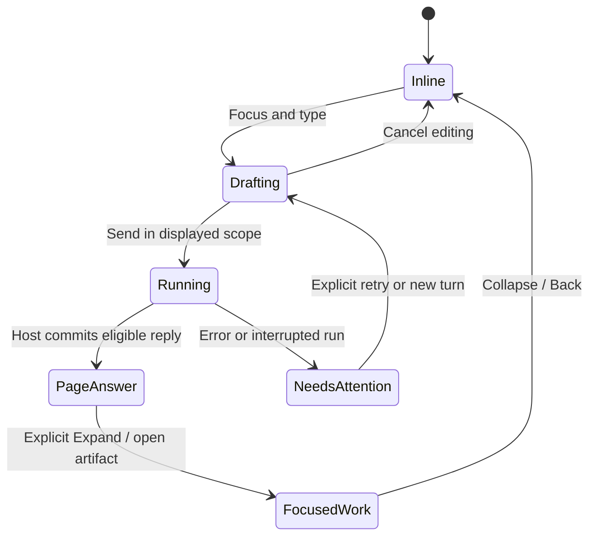
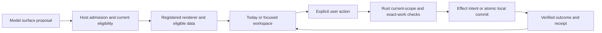

# Aksara fluid workspace: donor study and implementation plan

29 October 2026, Asia/Bangkok. Planning and tooling checkpoint. The user selected
Octopus SI OS, shadcn sidebar-08, Cult UI and Gooey as the next presentation
direction and asked to flesh it out before rebuilding. The shipped preview
still uses the OpenDuet checkpoint. This document replaces its phone-width
visual direction; it does not replace Aksara's authority or runtime decisions.

## Recommended experience

Aksara lives in the workspace. Today has an editable, visually unboxed prompt
directly beneath its heading. A short answer becomes page content. A longer
session can expand into a focused work surface, with its documents, decisions
and evidence alongside. The ongoing private conversation remains durable even
though Ask no longer has to be a separate primary destination.

Use flat materials and fluid transitions. Resting components share the page's
tone family, with grouping through spacing and small tonal differences. Shape
changes explain opening, joining, moving and completing work. They do not need
glass, deep shadows, extruded borders or a permanently animated background.

**Choose the inline composer plus expandable workspace.** Speech bubbles remain
useful inside shared conversations and for occasional short contextual remarks.
Turning every answer into a large bubble would push us back toward a chat app
and make tables, documents and ongoing work harder to read.

Focusing the input must not immediately open an overlay. Let people type, select
sources and use the keyboard in place. Send shows a response in the current
workspace; an explicit Expand action opens deeper work. An empty click or focus
change should not move the page unexpectedly.

## Read of the six supplied references

These images are visual references, not component source licenses or sources
for product data. Do not copy their people, financial metrics or brand assets.

| Reference                                       | Take into Aksara                                                                                                                                            |
| ----------------------------------------------- | ----------------------------------------------------------------------------------------------------------------------------------------------------------- |
| Crextio / yellow HR dashboard                   | Generous shape, a coherent field of surfaces, compact controls and readable large type. Keep the backdrop flat rather than importing its yellow light wash. |
| Financial dashboard with “Just ask me anything” | The most important interaction reference: the assistant's input belongs to the page beneath its title, with a small adjacent voice affordance.              |
| Learning dashboard on a laptop                  | Narrow icon rail, inset workspace, soft category tones and comfortable grouping. Charts appear only when actual data calls for them.                        |
| Haulix dark operations map                      | A useful dark-mode reading: navigation recedes and the working surface owns the space. A map is a domain screen, not a mandatory Today widget.              |
| Black/green Check Box dashboard                 | One neutral dark ground, legible status marks and bold but limited accents. Avoid turning every row into a bright signal.                                   |
| White analytics dashboard                       | A fluid desktop canvas, compact collapsed navigation and optional detail region. Use tonal grouping rather than repeating all its separators.               |

## Desktop, Surface Pro and phone layout

The desktop workspace fills the available width. Reading prose can have a
comfortable measure inside that workspace; the whole app is not capped to a
phone column. Surface Pro at display scaling must be treated as its own real
viewport, not assumed to have its panel's physical resolution in CSS pixels.

```text
┌─────────────────────────────────────────────────────────────────────────┐
│ Aksara · workspace / private context                    Search · Account │
│ ┌─────┐ ┌─────────────────────────────────────────────────────────────┐ │
│ │  A  │ │ Today                         Now / recorded date           │ │
│ │     │ │ What shall we move forward?  [sources] [voice*] [send]       │ │
│ │Today│ │                                                             │ │
│ │Work │ │ Aksara's concise brief / answer                              │ │
│ │Chan.│ │                                                             │ │
│ │Libr.│ │ Needs you                  In motion                         │ │
│ │Tools│ │ review / decision rows     current work and real status     │ │
│ │     │ │                                                             │ │
│ │ ⚙   │ │ Continue / recent artifacts        [optional focused pane]  │ │
│ └─────┘ └─────────────────────────────────────────────────────────────┘ │
└─────────────────────────────────────────────────────────────────────────┘
* Voice control appears only when the relevant capability is available.
```

Start from the real shadcn sidebar-08 block. It already uses `SidebarInset` and
`variant="inset"`; explicitly set `collapsible="icon"` and
`SidebarProvider defaultOpen={false}` to get the requested initially minimized
rail. The default block does not make those two choices for us. Replace its
Acme/demo navigation and placeholder dashboard with Aksara destinations/data.

Use the **Base UI variant**, configured as `base-nova`, to match our existing
Base UI dependency. The current official registry provides that sidebar-08
variant. This avoids importing the legacy Radix version by accident. Cult's
Halo forms and progress also already use Base UI.

Provisional geometry, to be checked in actual renders:

- Compact rail around 64–72 CSS px, with 44px minimum interactive targets and
  accessible names/tooltips. Expanded labels are an explicit toggle, not a
  surprise hover transformation.
- A small outer inset, around 8–12px, and a rounded inner workspace around
  24–28px. Controls and internal panels use a smaller related shape scale.
- Content grid uses the remaining width. A focused document/work pane is
  optional. At narrow widths, it becomes a route-backed full workspace rather
  than squeezing three columns onto the screen.
- Phone PWA keeps the same objects and operations. Navigation becomes a menu;
  focused work occupies the viewport, with reliable Back and a composer above
  the keyboard. No permanent desktop rail takes phone content width.
- First implementation renders at 1440, 1280, 1024, 768, 390 and 360 CSS px,
  plus 200% text size and browser zoom. Breakpoints follow component fit.

## Materials and motion

Use Material 3 principles through our React/Tailwind system: semantic color
roles, tonal containers, clear focus/selection, a consistent shape scale and
adaptive layout. We do not need a second complete UI framework to do that.

Start with a neutral base and a restrained configurable accent. Derive light
and dark role pairs and check text/control contrast. The exact accent is still
exploratory; workspace identity and warning/error colors remain distinguishable.

| Role                         | Starting treatment                                                                                                      |
| ---------------------------- | ----------------------------------------------------------------------------------------------------------------------- |
| App frame                    | Neutral tonal surface.                                                                                                  |
| Main workspace               | A nearby lighter/darker surface role; no glow or glass.                                                                 |
| Embedded prompt              | Page typography, visible caret and focus treatment; its hit area and accessible label stay explicit even without a box. |
| Reading / conversation prose | Primarily page ink, comfortable line length, little chrome.                                                             |
| Work groups                  | Spacing first, optional quiet tonal container.                                                                          |
| Selected rail destination    | Compact filled tonal selection plus current-page semantics.                                                             |
| Review and warnings          | Clear state and exact content; shape/color never substitutes for words.                                                 |
| Modal/popover                | Opaque material with a modest separation treatment where needed.                                                        |

Use one host motion policy. Initial targets are roughly 120–180ms for a small
control and 220–320ms for an opening surface, with a restrained spring where
it aids continuity. These are design starting values, not measurements.
Reduced motion removes travel and shape interpolation while preserving focus,
state and content. Explicit Performance mode also removes filter/shader effects.

**Gooey belongs on a small interaction**, such as a plus menu splitting into
actions or a selected segmented-control shape. It should not wrap Today, the
whole sidebar or a dense grid. Keep text and hit targets crisp and stable.

## What the donor code actually gives us

### Octopus SI OS

Studied current revision `49ba24226981dcdaadf32ff124dd3dc3a303371f`, MIT. This is
newer than the previous architecture-only study at `b07d76a`. It is a React 19,
Vite, Tailwind and Motion client over a Rust kernel, with Codex initially
integrated as an interface. The packaged desktop app currently assumes macOS,
Electron and several native/desktop dependencies. That is architectural
similarity, not drop-in compatibility with Aksara's PWA or authority model.

| Actual source                                                                          | Intended reuse / adaptation                                                                                                                                                                                  |
| -------------------------------------------------------------------------------------- | ------------------------------------------------------------------------------------------------------------------------------------------------------------------------------------------------------------ |
| `app/src/components/shell/AppShell.tsx`                                                | Study/adapt fluid rail/sidebar/workspace composition and compact layout. Replace runtime/task controllers and desktop titlebar integration with our host ports and shadcn shell.                             |
| `shell/SurfacePage.tsx`, `surfacePage.css`                                             | Reuse the small surface wrapper and container-aware content rules where useful.                                                                                                                              |
| `shell/WorkspacePaneManager.tsx`                                                       | Adapt its primary/secondary pane model, responsive overlay behavior and focus restoration. Replace command ownership hooks; use our established dialog behavior for modal cases.                             |
| `shell/PanelResizeHandle.tsx`, `panelResizeHandle.css`                                 | Candidate actual pane resize/animation source. Its `PanelContent` retains children during closing; add immediate invalidation for Aksara scope changes before reuse.                                         |
| `shell/HomeSurface.tsx`                                                                | Adapt continuing Home/activity/widget composition. It currently imports voice/runtime hooks; separate those from presentation.                                                                               |
| `voice/VoiceView.tsx`, `voice/HomeAgentActivityView.tsx`, `voice/HomeTurnActivity.tsx` | Extract the useful Home response/activity/widget presentation in bounded passes. Do not copy its whole voice session, ocean animation or runtime execution path.                                             |
| `client-surfaces/{types,documentRegistry,homePresentation,useHomeSurfaceDocuments}.ts` | Strong source for admitted, revisioned, scoped, expiring surface documents and conflict handling. Map these ideas to Aksara identities/read dependencies rather than equating a donor run ID with authority. |

`OperatorShell.tsx`, `Sidebar.tsx` and `VoiceView.tsx` have substantial domain
coupling. “Use Octopus UI” should mean a pinned source port with replaced data
ports, not carrying its entire Electron application or reimplementing every
visible component from a screenshot. Maintain a file-level reuse ledger as
pieces are imported. Preserve upstream MIT notices in the delivered UI.

### Cult UI and shadcn

Cult source studied at `d71b1428b811c2779d46ea41b7ef8c9f9c9991c2`, MIT, including
the actual registry implementations of the eight requested components. Registry
items copy source into the app. Their demos and interaction behaviors still
need adaptation to this product.

| Component             | Decision and concrete role                                                                                                                                                                                     |
| --------------------- | -------------------------------------------------------------------------------------------------------------------------------------------------------------------------------------------------------------- |
| **Expandable Screen** | Use its shared-layout expansion for an explicit focused work surface. Wrap/adapt with complete Base UI dialog behavior on modal layouts. Desktop can use a persistent pane instead.                            |
| **Speech Bubble**     | Secondary: shared messages, short contextual replies or onboarding. Its convenience text wrapper is an h1 with a decorative cursor; adapt to prose semantics and disable that cursor for normal messages.      |
| **Expandable**        | Primary Today building block: a compact decision/work row opens to evidence, latest activity and next actions. Use controlled state and unique IDs.                                                            |
| **Morph Surface**     | Good for capture, “add a note”, a short question or a small draft. Its local submit-success behavior must be replaced/bound to actual persistence. Exact approval is handled by trusted review UI.             |
| **Floating Panel**    | Optional contextual tools, source picker or quick details. Remove the blur, add collision handling/focus semantics, and await persistence before closing a form. It is not the app's main layout.              |
| **Halo Progress**     | Good Base UI-backed progress primitive. Use real determinate values for bounded uploads/downloads. A model or work loop with no known total stays indeterminate. Remove the demo's simulated percentage timer. |
| **Collab Toolbar**    | Good editor/work surface composition. Wire real actions and eligible audience. Replace its external avatar fallback with local initials/authorized images. It supplies neither CRDT editing nor real presence. |
| **AI Blob Warp**      | Optional small Aksara presence in a focused session or voice control. It uses Paper Design shaders, not just CSS. Lazy-load with static fallback and truthful runtime/audio states.                            |

Other relevant registry candidates: `side-panel`, `halo-input`, `halo-select`,
`halo-segmented`, and `wizard-expandable` for model setup/onboarding. Read each
source before adoption. Flatten Halo's default frosted/gradient treatments to
our tokens. `prompt-composer` has useful structure but its default shader and
rim do not match the requested unboxed page input; evaluate parts rather than
adopting its full appearance.

Source-level findings that prevent blind copy/paste:

- Expandable Screen uses a clickable `motion.div`; the inspected source has
  no complete modal keyboard/focus implementation and its scroll-lock effect
  does not restore prior overflow on unmount.
- Floating Panel's trigger has a constant `aria-expanded={false}`. Its modal
  declaration does not supply focus containment, and its form invokes a
  callback then closes without awaiting a persisted result.
- Morph Surface calls success when no submit handler exists. A successful
  callback is not an Aksara effect receipt. Its error path logs to the console;
  the product needs visible retry/error state and a non-leaking logging policy.
- Collab Toolbar falls back to `i.pravatar.cc` using the person's name in the
  URL. Remove this before real user data is used. Its icon buttons are
  presentational until handlers are supplied.
- Shared layout IDs must be unique per instance and context. Reusing a demo
  default across many Today cards creates incorrect motion matches.

These findings apply to the inspected versions. They do not imply that the
whole library has been tested or that its authors guarantee our use case.

### Gooey / Libraries.dev

`liquid-gooey@0.2.2`, MIT, source repository revision
`bad63221ebafa08d830586aa1721ecbd4ea02fcb`. It supports React 18+, so React 19
is within its stated peer range. It has no package runtime dependencies, but
that does not make SVG filters free to render.

Its source keeps a filtered silhouette behind crisp DOM content, uses reduced
motion helpers, and lets the observer engine sleep after settling. It also
contains specific WebKit raster-performance mitigations. Those are useful
engineering details, not evidence of Samsung A12 performance. Start with one
small merging control, use the flat fallback in Performance mode and measure.
Public MIT library code is usable; paid Studio recipes/presets and separately
licensed model downloads are not part of this selection.

## How Aksara's embedded conversation behaves



Drafting preserves the page and the user's place. Source selection is an
explicit adjacent control. Quick answers render as page prose with citations
and structured surfaces. Longer work has a durable work/thread ID and can be
expanded, minimized or revisited. Opening/closing its view does not start,
cancel or complete the underlying work. A separate Stop action asks the host
to interrupt work and reports the actual result.

Keep one composer instance/state per active context; resize moves presentation
without destroying the draft. The default Today composer targets the displayed
private thread. Shared Channel composers visibly name their audience. Changing
to a shared destination is explicit; an agent-created card cannot silently
reroute a private draft into it. Personal mode changes the authority host/store,
not merely the tint of the page.

The current adapter commits a model reply before showing it. The visual port
must retain that behavior. Streaming a decorative animation or typing indicator
does not justify displaying unvalidated partial model output.

## Today, work and the rest of the ecosystem

| Area                          | First useful presentation                                                            | Boundary / later capability                                                                                                             |
| ----------------------------- | ------------------------------------------------------------------------------------ | --------------------------------------------------------------------------------------------------------------------------------------- |
| Today                         | Current-scope brief, Needs you, In motion, recent eligible artifacts and Continue.   | Current backend is conversation-scoped. Office-wide aggregation needs a new eligible projection API; do not manufacture it client-side. |
| Recorded history              | Date control, recorded work states and clear limits.                                 | Full past office/document/membership reconstruction is still unimplemented. Historical display must also apply current access.          |
| Work                          | Expandable list/details, real status, source evidence and trusted review.            | WorkObject and receipts stay canonical in Rust.                                                                                         |
| Channels                      | Shared transcript plus work/artifact pane.                                           | Channel audience does not yet create channel-only artifact ACLs; current institution/private rules remain visible.                      |
| Library                       | Existing originals/search/document flow in a wider surface, with a source inspector. | Add rich parsing/indexing separately, preserving originals and read dependencies.                                                       |
| Memory                        | Proposed versus reviewed records, provenance, withdrawal and impact.                 | Surface layout is not approval to save memory or inject it into a model.                                                                |
| Packs and screens             | Available screens/capabilities, declarative metadata and real connection state.      | A manifest or installed UI component does not grant execution.                                                                          |
| Computers                     | Reserved work/artifact pane with unavailable/setup status today.                     | Private and shared computers need separate scoped sessions/controller generations; none is currently provisioned.                       |
| Hardware                      | Availability and reviewed simulator actions through the existing broker.             | An orb or toolbar is not physical microphone/device authority.                                                                          |
| Voice                         | Optional local read-aloud, then explicit qualified capture controls later.           | Pocket TTS is not dictation or a full voice conversation stack. Never show “listening” without actual capture.                          |
| Local/hosted models           | Clear provider, local setup/download and hosted per-turn consent.                    | Keyless free entitlement is not established by a model name; the prior real probe returned 429.                                         |
| Ruara / community publication | A distinct reviewed public projection/draft when implemented.                        | Private work, a shared channel and public release are separate audiences; no current forum adapter is enabled.                          |
| Onboarding                    | Connection/status checklist and a focused wizard when needed.                        | UI setup must not silently download large models, start capture or grant tools.                                                         |

Science, field/observatory, learning, clinic, government/cooperative/Adat,
archive/custody and experience/spatial tracks remain in the full component
coverage map. Their domain Packs can supply registered screens and workflows
through these same surface contracts as they are qualified. They do not need
separate ad hoc app shells or permission systems. A shared renderer does not
make an unimplemented domain adapter available.

## OpenUI and agent-manipulated surfaces

Expand from the current two text components in deliberate steps. Octopus's
surface admission/revision/expiry code is a strong donor, but the receiving
host must bind Aksara's principal, store, institution, lane, audience, purpose,
policy epoch and work revision/generation.

Proposed profile, not implemented APIs:

1. A model proposes a bounded `SurfacePlan` with a registered component key,
   resource references, content bounds and optional presentation preferences.
2. The host validates the plan, resolves currently eligible resources, and
   records the actual read dependencies used for generated content.
3. The client renders registered React components. The registry maps their
   appearance to flat, expandable or focused views. It does not evaluate
   model-written JavaScript, JSX, CSS or arbitrary fetch instructions.
4. A user action references a host-issued action/resource binding. The host
   rechecks current authority and stale work before retrieval or effects.
5. Revocation/context switch removes content immediately. Cancellation fences
   new execution while preserving evidence of effects already performed.

First registry candidates: Brief, WorkList, DecisionSummary, SourceList,
DocumentPreview, ActivityList and ProgressStatus. Start with read-only host-fed
data. Register trusted OpenWork/OpenSource navigation next. Approval, execution,
publication and permission controls remain host-owned review components.



User pins, focus, primary navigation, workspace/account choice and essential
warnings are outside agent layout control. Agent updates may refresh content
or suggest a card; they may not repeatedly rearrange the screen beneath the
pointer. Keep one focused surface/secondary pane active rather than introducing
a floating-window manager in the first pass.

Do not serialize the entire visible browser state into a model prompt just
because Octopus Home has a client-context snapshot mechanism. Aksara's host
materializes the authorized, bounded model input. Page visibility alone is not
an instruction to include every private title, document or channel in context.

Do not retain a private pane's children for a closing animation when the scope
changes. Clear the old subtree and late responses before showing the new
context. View-transition snapshots must not carry restricted content across
contexts. Generic layout preferences can be local; private content, transcripts,
artifact IDs/pins and resource-specific layout metadata need scoped host storage
or explicit qualification before persistence.

## Performance and accessibility gates

The economical baseline uses static tonal surfaces and Motion transforms for
short transitions. Gooey and Paper shaders are optional enhancements, with
lazy loading and explicit fallback. At most one decorative active presence
effect is needed; a grid of orbs and filtered cards is not the direction.

Measure build chunks, initial network cost, idle CPU/RSS, scroll/input latency,
opening/closing a populated work pane, long lists, tab suspension and reconnect.
Compare with the current preview before adding more effects. A 60Hz animation
has about 16.7ms per frame and 30Hz about 33.3ms; these are frame budgets, not
claims that this hardware achieves them. Actual A12 measurements are pending.

Required user journeys include keyboard rail/menu navigation, focus restoration,
screen-reader labels, reduced motion, 200% text, touch, IME composition,
multiline input, software keyboard resize, preserved drafts and Back/forward.
No global full-screen expansion just from focus. No drag-only essential action.
Unknown progress, no model, disconnected host and failed/uncertain effects each
have a distinct honest state.

Every existing real-platform privacy, exact approval, source withdrawal,
personal custody, simulator and PWA cache check stays applicable. Add focused
checks for stale animated content after a context switch, surface ID collisions,
OpenUI resource references after revocation, and page/pane resize with a draft.

## Implementation order and promotion points

1. **Tooling and source study — this pass.** Project-local Cult skill,
   components.json registry, pinned shadcn MCP, donor/source ledger and this
   decision document. Existing preview remains intact.
2. **Shell/source port.** Import the pinned sidebar-08 Base UI block and bounded
   Octopus surface/pane source. Replace its placeholder data and native host
   bindings with Aksara ports. Introduce one shared token/theme layer. Render
   real Today/Library/Tools states before adding ornamental motion.
3. **Embedded conversation.** Move the private Ask presentation into Today and
   focused work while retaining its canonical thread, explicit sources,
   consent, input handling and error/recovery behavior. Keep a discoverable
   conversation history entry even if Ask leaves primary navigation.
4. **Expandable Today and trusted details.** Controlled read-only summaries,
   host-owned review, document/source pane and measured responsive behavior.
   Use Cult source with the specific adaptation fixes above.
5. **Bounded OpenUI surface profile.** Implement/qualify receiving-side
   admission, resource resolution, revision/expiry, invalidation and rendering
   budgets. Then let the agent propose/persist scoped useful surfaces.
6. **Selective fluid enhancements.** One Gooey control and optional shader orb;
   benchmark and retain only what earns its cost. Rich collaboration, full
   history, capture, computers and physical hardware keep their existing gates.

No whole new backend, native app or framework migration is required for steps
2–4. This is a source reuse and presentation refactor over the existing platform.

## Installed setup and verification

- `apps/platform/components.json`: official-schema-valid Base UI configuration,
  existing aliases/CSS entry and `@cult-ui` registry. No component was installed
  into the running UI during this planning pass.
- `.agents/skills/cult-ui/SKILL.md`: a project-authored skill based on the official
  Cult agent rules, with the upstream license and Aksara adaptation checks.
- `.codex/config.toml`: shadcn MCP launch configuration. The small
  `scripts/cult_ui_mcp.mjs` launcher forces the app's working directory. In the
  tested CLI, supplying only its `--cwd` flag from the monorepo root did not
  make registry discovery find the app configuration.
- MCP protocol test initialized the server, listed seven tools and successfully
  searched `@cult-ui` for Expandable Screen. This verifies a separate stdio
  process. This chat's already loaded tool list does not dynamically gain those
  tools; a supporting Codex client must reload its MCP configuration. The
  launcher was tested on Linux; native Windows launch has not been exercised.

Run Codex from the repository root to load the project configuration. The
launcher is developer tooling, not an Aksara runtime tool exposed to its agents.

## Source links

- [Octopus repository](https://github.com/miuuyy/Octopus-SI-OS/tree/49ba24226981dcdaadf32ff124dd3dc3a303371f),
  [client guide](https://github.com/miuuyy/Octopus-SI-OS/blob/49ba24226981dcdaadf32ff124dd3dc3a303371f/docs/client.md),
  [surface registry source](https://github.com/miuuyy/Octopus-SI-OS/blob/49ba24226981dcdaadf32ff124dd3dc3a303371f/app/src/client-surfaces/documentRegistry.ts).
- [shadcn sidebar](https://ui.shadcn.com/docs/components/base/sidebar),
  [Base UI sidebar-08 registry](https://ui.shadcn.com/r/styles/base-nova/sidebar-08.json),
  [MCP documentation](https://ui.shadcn.com/docs/mcp).
- [Cult index](https://www.cult-ui.com/llms.txt),
  [agent setup](https://www.cult-ui.com/docs/llms),
  [MCP setup](https://www.cult-ui.com/docs/mcp-server),
  [pinned component source](https://github.com/nolly-studio/cult-ui/tree/d71b1428b811c2779d46ea41b7ef8c9f9c9991c2/apps/www/registry/default/ui).
- [Expandable Screen](https://www.cult-ui.com/docs/components/expandable-screen),
  [Speech Bubble](https://www.cult-ui.com/docs/components/speech-bubble),
  [Expandable](https://www.cult-ui.com/docs/components/expandable),
  [Morph Surface](https://www.cult-ui.com/docs/components/morph-surface),
  [Floating Panel](https://www.cult-ui.com/docs/components/floating-panel),
  [Halo Progress](https://www.cult-ui.com/docs/components/halo-progress),
  [Collab Toolbar](https://www.cult-ui.com/docs/components/collab-toolbar),
  [AI Blob Warp](https://www.cult-ui.com/docs/components/ai-blob-warp).
- [Gooey](https://libraries.dev/gooey),
  [pinned liquid-gooey source and license](https://github.com/Jakubantalik/Libraries.dev/tree/bad63221ebafa08d830586aa1721ecbd4ea02fcb/packages/liquid-gooey).
- [Material 3 color roles](https://m3.material.io/styles/color/roles),
  [motion](https://m3.material.io/styles/motion/overview). These pages require
  JavaScript; the exact token/geometry/motion values above are our proposed
  design decisions rather than extracted Google specifications.
